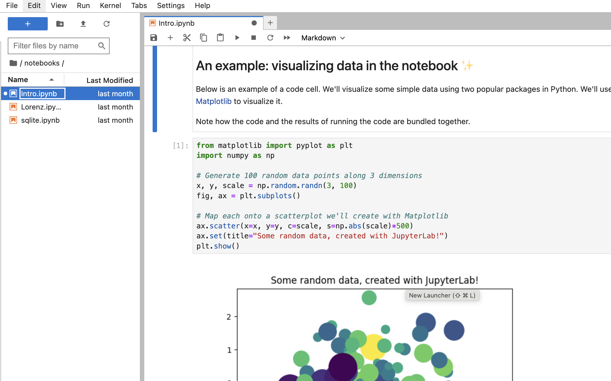
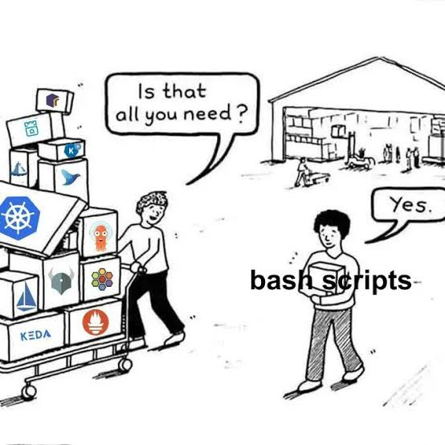
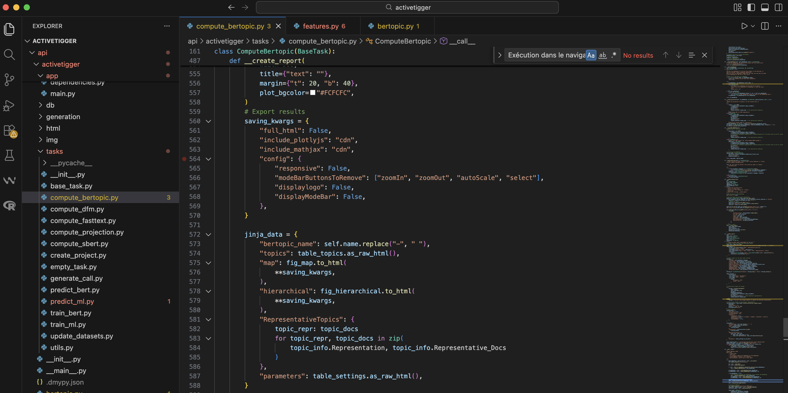

## Objectifs du module

- Comprendre ce qui se passe quand du code est exécuté
- Savoir exécuter le même code de trois manières
- Se repérer dans un terminal et dans ses dossiers
- Identifier les outils autour du langage, et ceux dont on a besoin au début


## C'est quoi un script ?

Un fichier texte qui contient des instructions, les unes sous les autres

```python
instruction 1
instruction 2
instruction 3
...
```


Il faut donc deux choses : Python installé quelque part (son ordinateur ou un serveur), et un endroit où écrire le code.

## Du texte à l'action

::: columns

:::: column
{fig-align="center"}
<!-- Source image : schéma maison (É. Schultz). -->
::::

:::: column


Python est un langage **interprété** : pas d'étape de compilation à lancer soi-même, le code est exécuté directement.

::::

:::

::: {.notes}
Descendre le schéma couche par couche. Reprendre la distinction compilation/interprétation de M1 sans s'y attarder.
:::

## Une exécution, ligne après ligne

- Les instructions sont lues **de haut en bas**, une par une
- Chaque variable créée est gardée **en mémoire vive**
- Quand le script se termine, la mémoire est libérée : tout disparaît
- Sauf ce qui a été **écrit sur le disque** (un fichier de résultats, un graphique)

Conséquence : relancer un script, c'est tout recommencer depuis la première ligne.

::: {.notes}
Le script de démo l'illustre : les variables disparaissent, `resultat.txt` reste.
:::

## Une erreur arrête l'exécution {.smaller}

```python
10 / 0
```

```
Traceback (most recent call last):
  File "script.py", line 2, in <module>
ZeroDivisionError: division by zero
```

- Ce qui précède l'erreur a été exécuté
- Ce qui suit ne l'est pas
- Le message dit où (la ligne) et quoi (la dernière ligne du message)

Faire des erreurs est normal. On apprendra à les lire dans le module suivant.

# Le terminal

## Deux manières de parler à un ordinateur {.smaller}

- **Interface graphique** (GUI) : la souris, tout est visible
    - on ne peut faire que ce que les boutons prévoient
- **Ligne de commande** (CLI) : le clavier, du texte
    - on écrit une commande, elle s'exécute, un résultat s'affiche, on recommence

Le **terminal** est la fenêtre ; le **shell** est le programme qui lit les commandes.

Où le trouver ?

- macOS / Linux : l'application Terminal
- Windows : PowerShell (ou l'application Terminal)
- Dans VS Code, dans Jupyter, dans les services en ligne

::: {.notes}
Beaucoup n'ont jamais ouvert de terminal. L'ouvrir en direct, montrer que rien ne casse. On retient peu de commandes : c'est un dialogue, on peut réessayer.
:::

## La structure d'une commande {.smaller}

```bash
ls -l data/
```

- un **nom** d'outil : `ls` (lister)
- des **options** qui modifient son comportement : `-l` (version détaillée)
- des **arguments** : sur quoi l'appliquer, ici le dossier `data/`

Lancer Python suit la même logique :

```bash
python script.py
```

L'outil est `python`, l'argument est le fichier à exécuter.

## Les fichiers sont rangés dans un arbre

- Tout est **fichier** ou **dossier**
- L'arbre part d'une racine : `/` (sous Windows `C:\`)
- Un **chemin** est l'adresse d'un fichier
    - **absolu**, depuis la racine : `/home/emilien/projet/data/tweets.csv`
        - change d'un ordinateur à l'autre
    - **relatif**, depuis l'endroit où l'on est : `data/tweets.csv`
        - fonctionne aussi chez un collègue

## On est toujours quelque part {.smaller}

Tout programme s'exécute depuis un **répertoire de travail**

- `pwd` : où suis-je ?
- `ls` : qu'y a-t-il ici ?
- `cd DOSSIER` : aller ailleurs

Quelques raccourcis

- `.` ici, `..` le dossier parent, `~` son dossier personnel
- `Tab` pour compléter un nom, `↑` pour retrouver la commande précédente
- `Ctrl+C` pour arrêter une commande


# Trois manières d'exécuter du code

## La console interactive

Taper `python` dans un terminal : l'interpréteur attend des instructions

```
>>> 2 + 2
4
>>> phrase = "Bonjour"
>>> len(phrase)
7
```

- Une ligne, un résultat, immédiatement
- Pratique pour tester une idée
- Rien n'est conservé quand on quitte (`exit()`)

## Le fichier `.py`

Écrire le code dans un fichier texte, puis demander à Python de l'exécuter

```bash
cd dossier_du_script
python script.py
```

- Tout le fichier est exécuté, du début à la fin
- Le code est conservé, partageable, relançable à l'identique
- C'est la forme la plus simple à reproduire

## Le notebook

Notebook computationnel : texte, code et résultats dans un même document (*programmation lettrée*)

{style="display:block; margin:auto" width="70%"}
<!-- Source image : capture d'écran de JupyterLab (notebook de démonstration Intro.ipynb) ; origine exacte à préciser. -->

[Du laboratoire à Jupyter : la trajectoire d'un instrument logiciel libre de la science ouverte, 2023](https://hal.science/hal-04316428/)

## Derrière le notebook : le noyau

- Le notebook est une **interface** : un fichier `.ipynb` avec des cellules de texte et de code
- Un **noyau** (*kernel*) Python exécute les cellules et garde les variables en mémoire
- Les cellules s'exécutent dans l'ordre où on les lance, pas dans l'ordre de la page
    - le numéro `[3]` indique l'ordre réel

Réflexe : **redémarrer le noyau et tout exécuter** avant de faire confiance à un résultat.

::: {.notes}
Démo : définir une variable, la modifier dans une cellule plus bas, réexécuter la cellule du haut. Puis redémarrer le noyau : les variables ont disparu.
:::

## Nous : notebooks Jupyter {.smaller}

Avantages

- Ludique et interactif
- Tous les éléments au même endroit
- Très utilisés (["Ten computer codes that transformed science", Nature, 2021](https://www.nature.com/articles/d41586-021-00075-2))

Limites

- Ordre d'exécution des cellules, vite confus
- Difficiles à versionner et à relancer à l'identique

Pour les critiques : [I don't like notebooks - Joel Grus](https://www.youtube.com/watch?v=7jiPeIFXb6U)

## En résumé {.smaller}

| | Console interactive | Fichier `.py` | Notebook |
|---|---|---|---|
| **Pour quoi** | Tester une ligne | Automatiser un traitement | Explorer, documenter |
| **Exécution** | Ligne par ligne | Tout le fichier, de haut en bas | Cellule par cellule, dans l'ordre choisi |
| **Ce qui reste** | Rien | Le code | Le code, le texte et les résultats |
| **Reproductible** | Non | Oui | Si on redémarre et qu'on exécute tout |

Le langage est le même dans les trois cas : seule la manière de le faire exécuter change.

# Où s'exécute le code ?

## Sur sa machine, ou ailleurs

- **En local** : Python est installé sur son ordinateur
    - ses fichiers, sa mémoire, son processeur
- **Sur un service distant** : le code tourne sur un serveur, on le pilote depuis le navigateur
    - les fichiers sont là-bas, pas sur son disque
- **Dans le navigateur** : sans installation, pour de petits essais

**Toujours se poser la question : où est exécuté mon code ? Avec quel matériel ?**

## Des services en ligne

- [SSP Cloud (INSEE)](https://datalab.sspcloud.fr/), qui repose sur le logiciel Onyxia
- [Google Colab](https://colab.research.google.com/) : GPU possibles
- Services institutionnels (universités, laboratoires...)

Points d'attention

- Les données quittent son ordinateur : attention aux données sensibles
- Les sessions ne sont pas permanentes : sauvegarder son travail
- Un compte est nécessaire

# Les outils autour du code

## Différentes philosophies d'outils

{fig-align="center" width="60%"}
<!-- Source image : mème « Is that all you need? » ; auteur non retrouvé. -->

On peut faire beaucoup avec peu : un éditeur de texte et un terminal suffisent.

## Les outils autour du code {.smaller}

Utiles dès le début

- **Éditeur / IDE** : écrire le code confortablement
- **Environnement virtuel** : isoler les bibliothèques d'un projet

Peuvent attendre

- **Formatter** : remettre le code en forme automatiquement
- **Linter** : signaler les maladresses et erreurs probables
- **Debugger** : exécuter pas à pas pour trouver une erreur
- **Assistants IA** : proposer, écrire ou exécuter du code

## Quel éditeur choisir ? {.smaller}

IDE : *Integrated Development Environment*

- un (simple) éditeur de texte
- un IDE complet (VS Code, Spyder, Positron)
- un environnement Jupyter

Ce que ça change

- Plus d'aides : coloration, complétion, mise en forme
- Plus de complexité...

Pour cette formation : des notebooks Jupyter, et un terminal.

## Généralisation de VS Code

{fig-align="center" width="75%"}
<!-- Source image : capture d'écran de VS Code par l'auteur. -->

Explorateur de fichiers, éditeur, terminal intégré, extensions (Python, Jupyter)

## Différents versions de Python : les environnement

Un **environnement** = une bulle = une version de Python + des bibliothèques, pour un projet

Différentes manière de gérer les environnements : `venv`, `conda`, `uv`...

**On le verra plus tard, mais bon à savoir**.

## Les distributions : Anaconda et les autres

Une distribution installe en une fois Python, des bibliothèques et un gestionnaire d'environnements (`conda`)

- **Anaconda** : longtemps le choix par défaut en data science
    - conditions d'utilisation devenues restrictives pour les grandes organisations
- [**Miniforge**](https://github.com/conda-forge/miniforge) : la même logique, avec le dépôt communautaire conda-forge

Quelle version de Python ? Une version récente et encore maintenue, pas forcément la toute dernière.


## Et l'IA dans tout ça ? {.smaller}

- Des assistants intégrés aux éditeurs (complétion, explication, correction)
- Des agents qui écrivent **et exécutent** du code, souvent dans le terminal

Les questions du module deviennent plus importantes quand on n'a pas écrit le code

- Où est-il exécuté ? Dans quel dossier ?
- Avec quels droits sur mes fichiers ?
- Qu'est-ce qu'il a modifié ?

Moins écrire, plus **lire** : comprendre une commande avant de la lancer.


## Mise en pratique {.smaller}

1. Récupérer le dossier sur le dépôt
2. Ouvrir un terminal, aller dans le dossier (`cd`), vérifier (`pwd`, `ls`)
3. Exécuter `python script.py`
4. Retrouver `resultat.txt` et l'ouvrir
5. Changer `nombre_min_lettres` dans le script, relancer
6. Ouvrir `notebook.ipynb` et exécuter les cellules une par une


## À retenir

- **Un script** est du texte, lu de haut en bas par un interpréteur
- **Le même code** s'exécute dans une console, un fichier ou un notebook
- **On est toujours quelque part** : savoir où tourne le code, et depuis quel dossier
- **Un environnement** regroupe une version de Python et des bibliothèques
- **Les outils** sont un confort, pas un prérequis

Ensuite : les bases du langage, en disséquant le script ligne par ligne.
