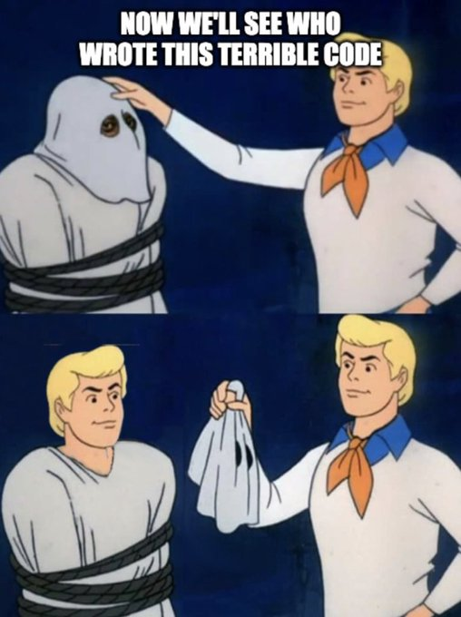
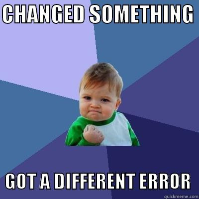
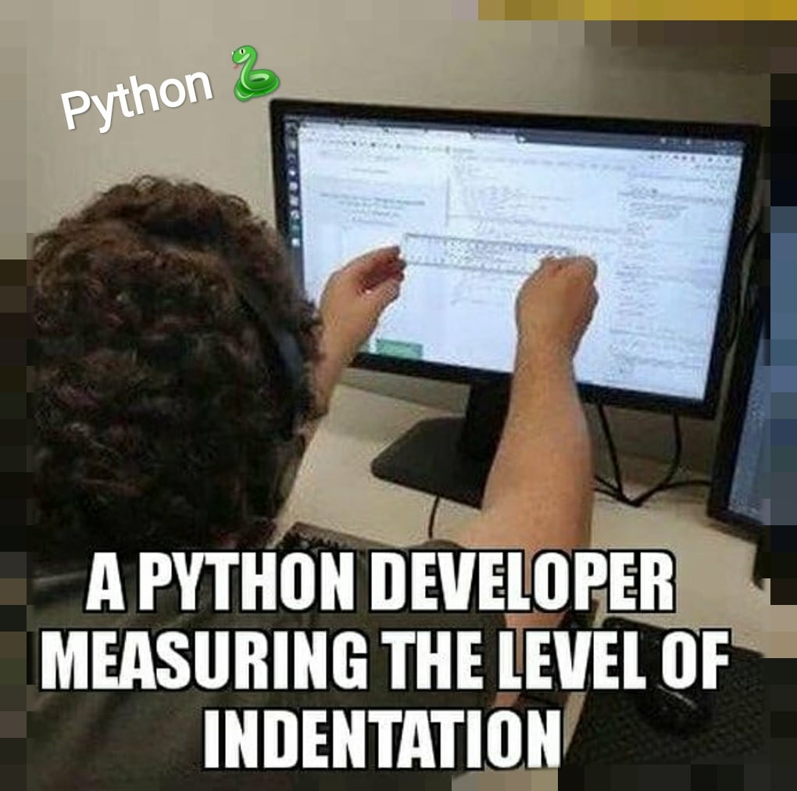

```{python}
#| include: false
# Variables utilisées dans les exemples exécutés (remplace input() au rendu)
sortie_fichier = True
nombre_min_lettres = 4
phrase = "Le sociologue observe, compte et interprète les pratiques."
liste_mots = phrase.split()
```

## Objectifs du module

- Lire un script Python **sans paniquer**
- Reconnaître les briques de base du langage : variables, types, conditions, boucles, fonctions, méthodes
- Savoir **lire un message d'erreur**
- Être capable de modifier un script existant

::: {.callout-note title="La méthode"}
Un seul script de 30 lignes, lu **ligne par ligne**. Chaque ligne est un prétexte pour introduire une notion.
:::

## Déroulé

| | Partie | Lignes du script |
|---|---|---|
| 1 | Variables, types, fonctions et méthodes | 1 à 5 |
| 2 | Conditions et boucles | 7 à 15 |
| 3 | Calculer, mettre en forme, écrire un fichier | 17 à 30 |
| 4 | Aller plus loin : écrire ses fonctions | `script_v2.py` |

Avec des temps de pratique entre chaque partie : **À vous de jouer**

## Le (code) bon, la brute et le truand

:::: {.columns}

::: {.column width="62%"}
- Des **contraintes de syntaxe** fortes : sinon ça ne marche pas
- Des **règles de qualité** : pour que ce soit lisible
    - [PEP 8 pour Python](https://peps.python.org/pep-0008/)
- L'important est souvent d'abord **d'écrire**, puis d'améliorer

On écrit surtout pour les humains qui reliront (*vous compris*)
:::

::: {.column width="38%"}
{width="85%"}
:::

::::

## Le script du jour {.script-complet}

```{.python code-line-numbers="true"}
sortie_fichier = True
nombre_min_lettres = 4

phrase = input("Écrivez une phrase : ")
liste_mots = phrase.split()

if len(liste_mots) == 0:
    print("Vous n'avez rien écrit")
else:
    nombre_mots = len(liste_mots)
    compteur = 0
    for mot in liste_mots:
        mot_nettoye = mot.strip(".,;:!?«»\"'()")
        if len(mot_nettoye) >= nombre_min_lettres:
            compteur += 1

    proportion = round(100 * compteur / nombre_mots, 2)
    informations = {
        "Total": compteur,
        "Proportion": proportion,
        "Phrase": phrase,
        "Seuil": nombre_min_lettres,
    }

    print(f"Proportion de mots avec {nombre_min_lettres} lettres ou plus : {proportion} %")

    if sortie_fichier:
        with open("resultat.txt", "w", encoding="utf-8") as f:
            for cle, valeur in informations.items():
                f.write(f"{cle} : {valeur}\n")
```

## Exécuter le script dans un notebook

1. Récupérer `script.py` sur le dépôt
2. Lancer un notebook
3. Copier le script dans une cellule et l'exécuter
4. Essayer plusieurs phrases, et aucune phrase

**À votre avis, que fait ce script ?**


**Maintenant on va l'analyser ligne par ligne**

# Variables et types {background-color="#1f5f8b"}

Lignes 1 à 5

## [Ligne 1]{.ligne} La variable

```{.python code-line-numbers="true"}
sortie_fichier = True
```

- Création d'une nouvelle entité : `sortie_fichier`
- Le signe `=` lui **affecte** un contenu : `True`
    - se lit de droite à gauche : « la valeur `True` est rangée dans `sortie_fichier` »
    - ce n'est pas l'égalité des mathématiques
- Ce contenu a un **type**, ici un booléen (vrai / faux)
    - Python le devine tout seul : *typage dynamique*

## C'est quoi une variable ?

Une entité qui existe pendant l'exécution du programme :

- avec un **nom**, que l'on choisit
- avec un **contenu**, dont le type détermine ce que l'on peut en faire, et qui peut être remplacé à tout moment

```{python}
age = 30
age = age + 1
age
```

[Supprimer une variable : `del age`]{.discret}

## Bien nommer ses variables

:::: {.columns}

::: {.column width="66%"}
**Les règles** (sinon erreur)

- lettres, chiffres et `_`, sans espace
- ne commence pas par un chiffre
- majuscules ≠ minuscules

**Les conventions** (PEP 8)

- `snake_case` : minuscules et `_`
- explicite : `nombre_mots`, pas `n`
:::

::: {.column width="34%"}

:::

::::

## En passant : les fonctions

Une **fonction** est un outil qui réalise une action :

- un nom, par exemple `type`
- des parenthèses pour l'appliquer à une entrée, et un résultat renvoyé

```{python}
type(sortie_fichier)
```

Autre exemple, afficher avec `print` :

```{python}
print("Sortie dans un fichier :", sortie_fichier)
```

## En passant : les commentaires

Tout ce qui suit un `#` est ignoré par Python

```{python}
# Seuil à partir duquel un mot est considéré comme long
nombre_min_lettres = 4  # à modifier selon le corpus
```

- Expliquer **pourquoi**, pas répéter ce que fait le code
- Pratique aussi pour désactiver temporairement une ligne
- Notre script n'en contient aucun : *à vous d'en ajouter*

## [Ligne 2]{.ligne} Un autre type : l'entier

```{python}
nombre_min_lettres = 4
type(nombre_min_lettres)
```

Comme c'est un entier, on peut le manipuler comme un nombre

```{python}
nombre_min_lettres + 10
```

## Attention au nom exact

Une majuscule de trop, et Python ne reconnaît plus la variable

```{python}
#| error: true
Nombre_min_lettres
```

**Notre première erreur !**

## Calculer avec des nombres

| Opération | Symbole | Exemple | Résultat |
|---|---|---|---|
| Addition, soustraction | `+` `-` | `7 + 2` | `9` |
| Multiplication | `*` | `7 * 2` | `14` |
| Division | `/` | `7 / 2` | `3.5` |
| Division entière | `//` | `7 // 2` | `3` |
| Reste (modulo) | `%` | `7 % 2` | `1` |
| Puissance | `**` | `7 ** 2` | `49` |

Deux types de nombres : `int` (entiers) et `float` (à virgule, écrite avec un **point**)

## Lire les erreurs

:::: {.columns}

::: {.column width="64%"}
Les erreurs sont **normales et utiles**

- Lire d'abord **la dernière ligne**
    - le type : `NameError`
    - l'explication : `… is not defined`
- Puis remonter : la flèche indique la ligne fautive
- Au besoin, copier le message dans un moteur de recherche ou une IA
:::

::: {.column width="36%"}

:::

::::

## Les erreurs les plus fréquentes {.petit-tableau}

| Erreur | Ce qu'elle veut dire | Cause typique |
|---|---|---|
| `SyntaxError` | phrase incompréhensible | parenthèse, guillemet ou `:` oublié |
| `IndentationError` | décalage incohérent | espaces en trop ou en moins |
| `NameError` | nom inconnu | faute de frappe, cellule non exécutée |
| `TypeError` | opération impossible pour ce type | `"dix" + 10` |
| `ValueError` | bon type, mauvaise valeur | `int("dix")` |
| `IndexError`, `KeyError` | élément inexistant | `liste[10]` s'il n'y a que 3 éléments |
| `FileNotFoundError` | fichier introuvable | mauvais chemin |

## [Ligne 4]{.ligne} Une entrée

```{.python code-line-numbers="true" startFrom="4"}
phrase = input("Écrivez une phrase : ")
```

- Une autre fonction standard : `input`
    - affiche un message et **attend** une saisie au clavier
    - renvoie ce qui a été saisi
- Le résultat est rangé dans la variable `phrase`
- Un nouveau type : la **chaîne de caractères** `str`

::: {.callout-warning title="Attention"}
`input` renvoie **toujours** du texte, même si l'on tape un nombre.
:::

## Les chaînes de caractères

- Quels guillemets ? Tous : `'texte'`, `"texte"`, et `"""texte"""` sur plusieurs lignes
- Échapper un guillemet : `'Je n\'y pense pas'`

```{python}
#| classes: code-long
phrase = "Le sociologue observe, compte et interprète les pratiques."
len(phrase)
```

Additionner des chaînes, c'est les **concaténer**

```{python}
"Bonjour" + " " + "à tous"
```

## Sélectionner dans une chaîne

Chaque caractère a une position, **en partant de 0**

```{python}
phrase[0]
```

```{python}
phrase[3:13]
```

```{python}
phrase[-1]  # les indices négatifs partent de la fin
```

`[début:fin]` est une **tranche** : `début` inclus, `fin` exclu

## Types et opérations

Le type détermine les opérations possibles

```{python}
#| error: true
"dix" + 10
```

Il faut alors **convertir** : `int()`, `float()`, `str()`

```{python}
int("10") + 10
```

## [Ligne 5]{.ligne} Les méthodes

```{.python code-line-numbers="true" startFrom="5"}
liste_mots = phrase.split()
```

Les variables sont des **objets** dotés d'outils : les **méthodes**

- Le `.` donne accès au contenu d'un objet : `objet.méthode()`
- Ici `split` découpe la chaîne à chaque espace et renvoie une **liste**

```{python}
print(liste_mots)
```

## Quelques méthodes des chaînes

```{python}
phrase.upper()
```

```{python}
phrase.replace("sociologue", "politiste")
```

```{python}
phrase.count("e")
```

- Une méthode **renvoie** un résultat : `phrase` n'est pas modifiée
- Les découvrir : touche `Tab` après le point, ou [la documentation](https://docs.python.org/fr/3/library/stdtypes.html#string-methods)

## Les listes

Une suite **ordonnée** d'éléments, indexée par les entiers 0, 1, 2…

```{python}
liste = [53, "deux", 1]
liste[1:]
```

On peut la modifier : ajouter, remplacer, retirer

```{python}
liste.append("nouvel élément")
liste[0] = 54
liste
```

## Les types de base

| Type | Nom | Exemple |
|---|---|---|
| `bool` | booléen | `True`, `False` |
| `int` | entier | `4` |
| `float` | nombre à virgule | `3.14` |
| `str` | chaîne de caractères | `"une phrase"` |
| `list` | liste | `[1, 2, 3]` |
| `dict` | dictionnaire | `{"nom": "Durkheim"}` |
| `NoneType` | la valeur nulle | `None` |

[Et aussi : `tuple` (liste non modifiable), `set` (ensemble sans doublon)…]{.discret}

## La valeur nulle

`None` représente l'**absence de valeur**

- Différent de `0`, de `""` ou de `False`
- Fréquent pour une donnée manquante
- C'est ce que renvoie une fonction qui ne renvoie rien, comme `print`

```{python}
resultat = print("Bonjour")
```

```{python}
resultat is None
```

## À vous de jouer {background-color="#e8f1f7"}

Sans exécuter le code, puis en vérifiant :

1. Quel est le type de la variable `v` si `v = 1.1` ?
2. Pourquoi a-t-on une erreur si on fait `10 + "vingt"` ?
3. Est-ce que `variable1` et `Variable1` sont la même variable ?
4. Que vaut `"Python"[1]` ? Et `"Python"[-2:]` ?
5. Que renvoie `"un,deux,trois".split(",")` ?

[Notebook `Exercices m3.ipynb`, partie 1]{.discret}

# Conditions et boucles {background-color="#1f5f8b"}

Lignes 7 à 15

## Les blocs d'un script

- Un script est un écoulement d'instructions
    - exécutées les unes après les autres, de haut en bas
- Cet écoulement est organisé par des **blocs** :
    - des **conditions** : exécuter ou non
    - des **répétitions** : exécuter plusieurs fois

Dans notre script : un `if`, qui contient un `for`, qui contient un `if`

## Conditions : `if`, `else`

Faire un choix selon qu'une affirmation est vraie ou fausse

```{.python}
if CONDITION:
    CODE 1
else:
    CODE 2
```

- Le CODE 1 est exécuté si la condition est vraie, sinon c'est le CODE 2
- Le `else` est facultatif

## Plus de deux cas : `elif`

Pour enchaîner plusieurs conditions : `elif` (*else if*)

```{.python}
if age < 18:
    categorie = "mineur"
elif age < 65:
    categorie = "actif"
else:
    categorie = "retraité"
```

- Les conditions sont testées **dans l'ordre**
- Dès que l'une est vraie, son bloc est exécuté et les suivantes sont ignorées

## Écrire une condition

Une expression dont le résultat est `True` ou `False`

| Test | Symbole | Exemple |
|---|---|---|
| Égal | `==` | `test == 10` |
| Différent | `!=` | `test != 10` |
| Plus grand, plus petit | `>` `<` `>=` `<=` | `test >= 4` |
| Appartient à | `in` | `"a" in phrase` |
| Est la valeur nulle | `is None` | `test is None` |

::: {.callout-warning title="Le piège classique"}
`=` affecte une valeur, `==` teste une égalité.
:::

## Logique booléenne

Combiner des conditions avec trois opérateurs

| Opérateur | Vrai si… | Exemple |
|---|---|---|
| `and` | les deux sont vraies | `x > 0 and x < 10` |
| `or` | au moins une est vraie | `x < 0 or x > 10` |
| `not` | la condition est fausse | `not sortie_fichier` |

```{python}
len(phrase) > 10 and "sociologue" in phrase
```

[Avec Pandas, ces opérateurs s'écriront `&`, `|` et `~`]{.discret}

## [Lignes 7 à 9]{.ligne} Condition sur l'entrée

```{.python code-line-numbers="true" startFrom="7"}
if len(liste_mots) == 0:
    print("Vous n'avez rien écrit")
else:
```

- `len` renvoie la longueur d'un ensemble : liste, chaîne, dictionnaire…
- Le test : la liste de mots est-elle vide ?
    - si oui, afficher un message
    - sinon, tout le reste du script est exécuté (bloc `else`)
- La ligne se termine par `:`
- **Le code du bloc est indenté de 4 espaces**

## Python et les indentations

:::: {.columns}

::: {.column width="60%"}
- Le décalage **délimite** les blocs
- **4 espaces** par niveau (touche `Tab`)
- Pas de la décoration : **indispensable**
- Un bloc s'ouvre toujours après un `:`
- Revenir à gauche, c'est sortir du bloc
:::

::: {.column width="40%"}

:::

::::

## L'indentation change le sens

:::: {.columns}

::: {.column width="50%"}
```{python}
for mot in ["a", "b"]:
    print(mot)
    print("fin")
```
:::

::: {.column width="50%"}
```{python}
for mot in ["a", "b"]:
    print(mot)
print("fin")
```
:::

::::

Le second `print` est **dans** la boucle à gauche, **après** la boucle à droite

## Trois niveaux emboîtés dans notre script

```{.python code-line-numbers="true" startFrom="9"}
else:
    nombre_mots = len(liste_mots)
    compteur = 0
    for mot in liste_mots:
        mot_nettoye = mot.strip(".,;:!?«»\"'()")
        if len(mot_nettoye) >= nombre_min_lettres:
            compteur += 1
```

- niveau 1 : le bloc `else`
- niveau 2 : le bloc `for`, répété pour chaque mot
- niveau 3 : le bloc `if`, exécuté seulement pour les mots longs

## [Lignes 10 et 11]{.ligne} Préparer le comptage

```{.python code-line-numbers="true" startFrom="10"}
    nombre_mots = len(liste_mots)
    compteur = 0
```

- Deux nouvelles variables, créées **seulement si** la phrase n'est pas vide
- `nombre_mots` : le résultat d'une fonction rangé dans une variable
- `compteur` : démarre à 0, il va augmenter au fil de la boucle

## [Ligne 12]{.ligne} Une boucle

```{.python code-line-numbers="true" startFrom="12"}
    for mot in liste_mots:
```

- Une boucle **répète** une opération
- En Python, la boucle `for` parcourt un ensemble
    - à chaque tour, l'élément courant est rangé dans une variable temporaire

```{.python}
for VARIABLE_TEMPORAIRE in ENSEMBLE:
    CODE avec VARIABLE_TEMPORAIRE
```

## La boucle `for` en action

Le bloc indenté est exécuté une fois par élément

```{python}
for element in ["ceci", "est", 1, "liste"]:
    print(element)
```

`element` vaut successivement `"ceci"`, puis `"est"`, puis `1`…

## Tout (ou presque) peut être parcouru

```{python}
for lettre in "Oui":
    print(lettre)
```

Et avec le rang de chaque élément :

```{python}
for rang, lettre in enumerate("Oui"):
    print(rang, lettre)
```

## Générer une suite d'entiers avec `range`

`range(0, 3)` : les entiers de 0 à 2 (**la borne de fin est exclue**)

```{python}
for i in range(0, 3):
    print(i)
```

- Utile pour répéter une action un nombre de fois donné
- `range(3)` est équivalent à `range(0, 3)`

[Il existe aussi la boucle `while`, qui répète tant qu'une condition est vraie]{.discret}

## [Ligne 13]{.ligne} Nettoyer chaque mot

```{.python code-line-numbers="true" startFrom="13"}
        mot_nettoye = mot.strip(".,;:!?«»\"'()")
```

- `strip` retire des caractères **au début et à la fin** d'une chaîne
    - sans argument : les espaces
    - ici : les signes de ponctuation listés
- Sinon `"pratiques."` compterait 10 lettres au lieu de 9

```{python}
"(pratiques).".strip(".,;:!?«»\"'()")
```

## [Lignes 14 et 15]{.ligne} Compter sous condition

```{.python code-line-numbers="true" startFrom="14"}
        if len(mot_nettoye) >= nombre_min_lettres:
            compteur += 1
```

- Pour chaque mot, tester si sa longueur atteint le seuil
- Si c'est le cas, augmenter le compteur de 1
- `compteur += 1` est un raccourci pour `compteur = compteur + 1`
- Pas de `else` : si le mot est trop court, on ne fait rien

## Un schéma classique : le comptage

```{python}
compteur = 0
for mot in liste_mots:
    mot_nettoye = mot.strip(".,;:!?«»\"'()")
    if len(mot_nettoye) >= nombre_min_lettres:
        compteur += 1
compteur
```

Un compteur à 0, une boucle, une addition de 1 sous condition : un schéma que l'on retrouve partout, objet de l'**algorithmique**

## La compréhension de liste

Construire une liste à partir d'une boucle, en une ligne

```{python}
[len(mot) for mot in liste_mots]
```

Avec une condition :

```{python}
[mot for mot in liste_mots if len(mot) >= 8]
```

[Très fréquent dans le code Python que vous lirez : à savoir reconnaître avant de savoir écrire]{.discret}

## À vous de jouer {background-color="#e8f1f7"}

En repartant du script et en modifiant les blocs appropriés :

1. Créer une variable contenant une phrase, compter le nombre de « a » et afficher le résultat
2. Demander une phrase et afficher son nombre de mots
3. Demander une phrase et afficher son dernier mot (indice : `ma_liste[-1]`)

[Notebook `Exercices m3.ipynb`, partie 2 (exercices 2.4 à 2.6)]{.discret}

# Calculer, mettre en forme, enregistrer {background-color="#1f5f8b"}

Lignes 17 à 30

## [Ligne 17]{.ligne} Faire un calcul

```{.python code-line-numbers="true" startFrom="17"}
    proportion = round(100 * compteur / nombre_mots, 2)
```

- La fonction `round` arrondit, ici à 2 décimales
    - une fonction peut prendre **plusieurs entrées**, séparées par des virgules
- Cette ligne est **sortie de la boucle** : elle n'est exécutée qu'une fois

```{python}
nombre_mots = len(liste_mots)
proportion = round(100 * compteur / nombre_mots, 2)
proportion
```

## [Lignes 18 à 23]{.ligne} Un dictionnaire

```{.python code-line-numbers="true" startFrom="18"}
    informations = {
        "Total": compteur,
        "Proportion": proportion,
        "Phrase": phrase,
        "Seuil": nombre_min_lettres,
    }
```

- Rassembler des informations dans un seul objet
- Des paires `clé: valeur`, entre accolades
- Entre parenthèses, crochets ou accolades, on peut aller à la ligne librement

## Les dictionnaires

On accède à une valeur par sa **clé** et non par sa position

```{python}
informations = {"Total": compteur, "Proportion": proportion}
informations["Total"]
```

Ajouter ou modifier une entrée

```{python}
informations["Seuil"] = nombre_min_lettres
informations
```

Un bon conteneur pour des données structurées (cf. le format **JSON**)

## [Ligne 25]{.ligne} Mettre en forme du texte

```{.python .code-long code-line-numbers="true" startFrom="25"}
    print(f"Proportion de mots avec {nombre_min_lettres} lettres ou plus : {proportion} %")
```

Insérer des valeurs dans du texte, c'est le **formatage**. Avec les *f-strings* : un `f` avant les guillemets, les variables entre `{}`

```{python}
#| classes: code-long
print(f"Proportion de mots avec {nombre_min_lettres} lettres ou plus : {proportion} %")
```

[Anciennes écritures que vous croiserez : `"un %d" % variable`, `"un {}".format(variable)`]{.discret}

## [Ligne 27]{.ligne} Un booléen comme condition

```{.python code-line-numbers="true" startFrom="27"}
    if sortie_fichier:
```

- La variable de la ligne 1 sert enfin !
- Elle contient déjà `True` ou `False` : inutile d'écrire `== True`
- Une variable placée en haut du script pour **paramétrer** son comportement
    - passer à `False` pour ne pas écrire de fichier
    - même logique pour `nombre_min_lettres`

## Lire et écrire dans un fichier

Un fichier est stocké sur le disque, pas dans la mémoire du programme. Il faut donc :

1. **ouvrir** un lien vers le fichier, en précisant le mode
2. **faire** une opération
3. **fermer** ce lien

| Mode | Usage |
|---|---|
| `"r"` | lire (*read*) |
| `"w"` | écrire, en **écrasant** le contenu existant (*write*) |
| `"a"` | écrire à la suite (*append*) |

## [Lignes 28 à 30]{.ligne} Écrire le résultat

```{.python code-line-numbers="true" startFrom="28"}
        with open("resultat.txt", "w", encoding="utf-8") as f:
            for cle, valeur in informations.items():
                f.write(f"{cle} : {valeur}\n")
```

- `open` ouvre `resultat.txt` en écriture ; `encoding="utf-8"` (argument **nommé**) évite les problèmes d'accents
- `with … as f:` un bloc qui ferme le fichier automatiquement à la fin
- `.items()` parcourt le dictionnaire, clé et valeur en même temps
- `f.write` écrit du texte, `\n` fait le saut de ligne

## Lire un fichier

Même logique, avec le mode `"r"` et la méthode `read`

```{python}
#| include: false
with open("resultat.txt", "w", encoding="utf-8") as f:
    for cle, valeur in {**informations, "Phrase": phrase}.items():
        f.write(f"{cle} : {valeur}\n")
```

```{python}
with open("resultat.txt", "r", encoding="utf-8") as f:
    contenu = f.read()

print(contenu)
```

Le chemin est relatif au dossier d'exécution : `"dossier/fichier.txt"`

```{python}
#| include: false
import os
os.remove("resultat.txt")
```

## À vous de jouer {background-color="#e8f1f7"}

1. Demander deux phrases et les afficher concaténées
2. Comprendre ce que fait la méthode `capitalize` ([documentation](https://docs.python.org/fr/3/library/stdtypes.html#string-methods))
3. Modifier le script : seuil de 6 lettres, et fichier nommé `mots_longs.txt`
4. Ajouter dans le fichier de sortie le nombre total de mots

[Notebook `Exercices m3.ipynb`, parties 1 et 3 (exercices 1.5, 1.8 et 3.6)]{.discret}

# Aller plus loin : écrire ses fonctions {background-color="#1f5f8b"}

`script_v2.py`

## Deux types de fonctions

Une **fonction** : un morceau de code qui prend des entrées et produit une sortie, auquel on donne un nom pour le réutiliser sans le recopier

- Celles déjà disponibles, écrites par d'autres
    - rencontrées aujourd'hui : `print`, `type`, `input`, `len`, `round`, `range`, `open`
- Celles que l'on écrit soi-même

## Définir une fonction

```{.python}
def NOM_FONCTION(ENTREE1, ENTREE2):
    OPERATION 1
    OPERATION 2
    return RETOUR
```

`def`, un nom, les entrées entre parenthèses, puis un bloc indenté qui se termine par `return` : ce qu'elle renvoie

```{python}
def calculer_proportion(compteur, total):
    return round(100 * compteur / total, 2)

calculer_proportion(3, 8)
```

## Le même script, avec des fonctions

```{.python}
def nettoyer_mot(mot):
    return mot.strip(PONCTUATION)

def compter_mots_longs(liste_mots, seuil):
    compteur = 0
    for mot in liste_mots:
        if len(nettoyer_mot(mot)) >= seuil:
            compteur += 1
    return compteur
```

- Le comptage, **rangé dans une boîte** qui porte un nom
- Comparer `script.py` et `script_v2.py` : qu'est-ce qui a changé ?

## Pourquoi écrire une fonction ?

- Pour ne pas répéter le code
- Pour monter en abstraction
    - `compter_mots_longs(liste_mots, 4)` se lit presque comme une phrase
- Pour aller vers la modularité des opérations
- Pour faciliter la lecture, les tests et les corrections

[À vous de jouer : notebook `Exercices m3.ipynb`, partie 4]{.discret}

# Pour finir {background-color="#1f5f8b"}

## Ce que l'on a vu

| Notion | Dans le script |
|---|---|
| Variable et affectation | `nombre_min_lettres = 4` |
| Types | `True`, `4`, `"texte"`, `[…]`, `{…}` |
| Fonction | `len(liste_mots)`, `round(…, 2)` |
| Méthode | `phrase.split()`, `mot.strip(…)` |
| Condition | `if … :` / `else:` |
| Boucle | `for mot in liste_mots:` |
| Formatage | `f"… {proportion} %"` |
| Fichier | `with open(…) as f:` |

## Ce que l'on n'a pas vu

- les classes : créer ses propres types d'objets
- la gestion des erreurs : `try` / `except`
- la boucle `while`
- les bibliothèques et `import` : **c'est le module suivant**

## Où trouver de l'aide ?

- Lire le message d'erreur, **jusqu'au bout**
- `help(fonction)` ou `fonction?` dans un notebook
- La [documentation officielle](https://docs.python.org/fr/3/), en français
- Les assistants IA : efficaces pour expliquer une erreur ou une ligne de code
    - à condition de comprendre ce qu'ils répondent, d'où ce module
- **Tester** de petits bouts de code dans une cellule, pour voir ce qui se passe
